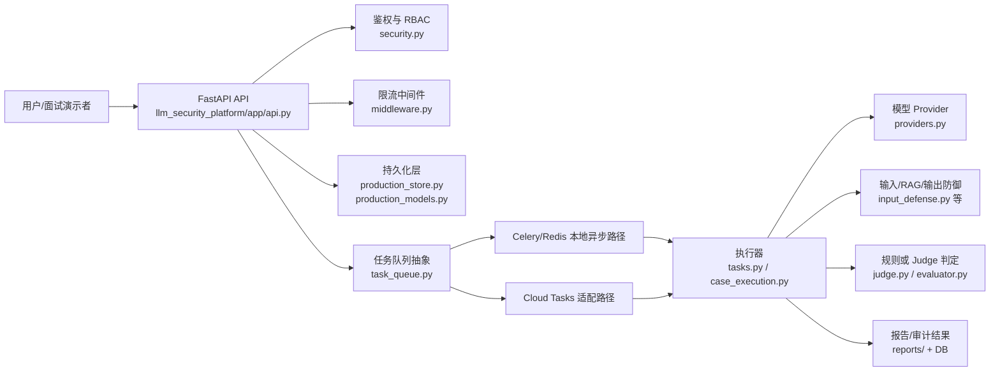
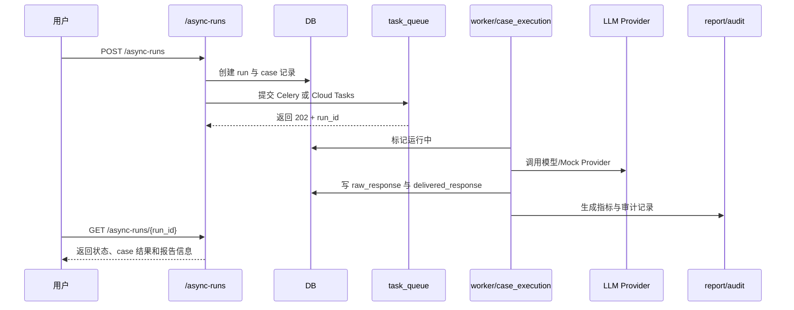

# 高阶架构深挖：证据边界版

> 本文用于面试深挖，不用于把项目包装成生产安全网关。所有结论以当前仓库代码、测试与报告为边界；仓库中未验证的能力会明确标出。

## 1. 安全定位

这个项目当前最稳妥的定位是：

> 面向内部 AI 平台、安全或研发团队的 LLM/RAG 安全评测与防御策略对比平台，用来批量复现 Prompt Injection、Jailbreak、RAG 泄露等风险，并保存可审计结果。

不能直接说成：

- 生产级实时 LLM 防火墙
- 公开 SaaS 安全产品
- 能保证拦住全部越狱或全部泄露的系统
- 已被真实客户长期验证 ROI 的企业平台

## 2. 当前可验证架构

对应证据：

| 层 | 当前证据 | 能说明什么 | 不能夸大成什么 |
|---|---|---|---|
| API 层 | `llm_security_platform/app/api.py` 中 `/runs`、`/async-runs`、`/human-reviews`、`/audit-logs`、`/policies`、`/ws` | 有评测、异步、人审、审计、策略、WebSocket 查询/推送入口 | 不是完整企业网关 |
| 鉴权/RBAC | `llm_security_platform/app/security.py` 的 `ROLE_PERMISSIONS`、`require_permission` | viewer/analyst/reviewer/admin 权限边界存在 | 不等于企业 SSO/LDAP/组织权限体系 |
| 限流 | `llm_security_platform/app/middleware.py` | Redis 滑动窗口；Redis 故障时写请求 fail-closed，读请求本地 fallback | 不等于多区域全局限流 |
| 异步 | `llm_security_platform/app/task_queue.py`、`llm_security_platform/app/tasks.py`、`scripts/cloud_e2e_smoke_test.py` | 支持 Celery 与 Cloud Tasks 两类任务入口，并提供本地/远端 Cloud smoke 脚本 | 若没有原始云端日志，不能说真实 GCP 长期稳定运行 |
| 成本控制 | `llm_security_platform/app/cost_guardrail.py` | run/user/tenant token budget，Redis + DB 同步/回退 | 不是精确账单系统 |
| 测试 | `uv run pytest -q` | 本轮本地 124 个测试通过 | 不能证明长期生产稳定性 |
| 容器 | `llm_security_platform/docker-compose.yml`，`docker compose ... config --quiet` | Compose 配置语法可解析 | 本轮没有实际启动容器服务 |

## 3. 多租户隔离的真实边界

`llm_security_platform/app/production_store.py:session_scope` 在 PostgreSQL 且 tenant 不是 `default` 时，会创建 schema 并执行 `SET LOCAL search_path TO {tenant_id}`。这说明项目做了 PostgreSQL schema 级租户路由。

面试时可以说：

> 我用 PostgreSQL schema + `SET LOCAL search_path` 做租户级数据路由，并通过 tenant id 校验和测试覆盖降低串租风险。

不要说：

> 物理隔离、绝对隔离、彻底杜绝横向越权。

原因：仓库中没有证明多实例物理隔离、跨区域隔离、真实恶意租户长期攻击验证；`SET LOCAL` 的隔离强度依赖事务边界和连接使用方式。

## 4. 异步与失败恢复

当前异步路径不是只演示一个 `/chat`，而是：

可讲点：

- `/async-runs/{run_id}/cancel`、`/async-runs/{run_id}/retry` 提供取消与重试入口。
- `stage_5_6_fault_drill.json` 有历史故障演练结果，覆盖 worker interruption、Redis restart、model timeout、duplicate delivery、case failure、task cancellation。
- 本轮本地 `uv run pytest -q` 通过 124 个测试，说明回归测试没有明显断裂。

边界：

- Cloud Tasks 路径代码与 smoke 脚本存在；如果要说“真实 GCP 已跑通”，需要同时展示脱敏 Cloud Run URL、Cloud Tasks 派发日志或 GCS 归档产物。
- 不能说“外部模型失败一定可自动补偿完成”，只能说“失败状态可见，部分路径支持重试或恢复”。

## 5. RAG/防御/Judge 指标怎么讲

面试里最重要的是区分三个指标：

| 指标 | 含义 | 为什么重要 |
|---|---|---|
| raw ASR | Provider 原始响应是否被判定为攻击成功 | 衡量模型原生脆弱性 |
| delivered ASR | 经过输出防御后最终交付内容是否仍危险 | 衡量用户真正暴露风险 |
| benign refusal | 正常请求被误拒比例 | 衡量防御副作用 |

安全表达：

> 项目把原始模型妥协和最终交付攻击成功分开保存，避免把“模型说错了但被输出防御拦住”混成同一个结果。

避免表达：

> 防御策略已经证明 100% 有效。

## 6. 当前最有含金量的工程点

1. 异步评测闭环：`/async-runs` 创建、队列提交、worker 执行、结果持久化、查询/导出。
2. RBAC 与审计：`security.py` 的角色权限、`api.py` 的权限依赖、`/audit-logs`。
3. Redis 故障安全策略：写请求 fail-closed，读请求本地 fallback。
4. token budget：run/user/tenant 三层预算和 DB 同步。
5. 测试证据：本轮 `uv run pytest -q`，结果为 `124 passed`。

## 7. 仍然不能夸大的能力

- 真实企业用户效果：仓库中未验证。
- 长期云端稳定运行：仓库中未验证。
- 完整 SSO/IAM/组织治理：仓库中未验证。
- 真实 ROI、成本节省比例：仓库中未验证。
- 拦截全部越狱/RAG 泄露：不应承诺。
