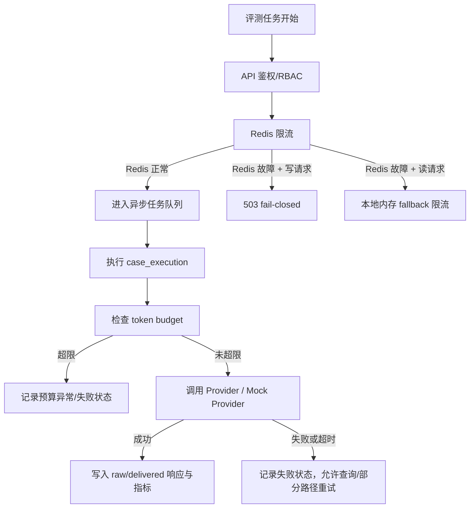

# Agent/模型失败与降级策略：证据边界版

> 本文只描述当前仓库中能从代码、测试或报告支持的失败处理能力。没有代码证据的“自动补偿、智能路由、生产级熔断网格”等说法不作为当前项目能力。

## 1. 失败处理总览

## 2. 当前已实现且可讲的策略

| 场景 | 当前处理 | 证据 | 面试表达 |
|---|---|---|---|
| Redis 限流不可用 | 写请求返回 503；读请求使用本地内存限流 fallback | `llm_security_platform/app/middleware.py` | “默认写路径偏安全，避免限流失效时继续制造昂贵任务。” |
| token 预算超限 | run/user/tenant 三层预算检查，超限抛出 `BudgetExceededError` | `llm_security_platform/app/cost_guardrail.py` | “我把成本失控当成安全问题处理，在模型调用前后做预算记录。” |
| 异步任务失败 | run/case 状态可查询，提供 cancel/retry 入口 | `llm_security_platform/app/api.py` 的 `/async-runs/{run_id}`、`/cancel`、`/retry` | “失败不是静默丢失，用户能看到状态并触发恢复动作。” |
| Cloud Tasks 回调 | `/tasks/execute-run` 接收 worker 执行请求，Cloud Tasks 配置可指定 OIDC service account | `llm_security_platform/app/task_queue.py`、`api.py` | “云任务路径有代码适配，但本轮未在真实云环境重新验收。” |
| 故障演练 | 历史报告覆盖 worker interruption、Redis restart、model timeout、duplicate delivery 等 | `llm_security_platform/reports/stage_5_6_fault_drill.json` | “这是受控演练证据，不等同长期生产 SLA。” |

## 3. 不应再使用的过满说法

| 不建议说 | 更安全的说法 |
|---|---|
| “Tenacity 指数退避保证任务最终完成” | “任务失败状态可见，部分路径提供重试入口；是否自动退避要看具体队列/任务配置。” |
| “TikToken 精确前置计费” | “当前有 token budget guardrail；具体 token 估算/计费精度以实现和 provider 返回为准。” |
| “延迟补偿队列保证外部服务恢复后自动完成” | “仓库中未验证完整延迟补偿队列；可以手动/接口触发 retry。” |
| “模型失败后自动切本地模型保证可用” | “Provider/Mock Provider 可用于测试；真实自动模型路由需看当前配置，不能泛化承诺。” |
| “熔断后毫秒级返回” | “失败路径有保护机制，但仓库没有端到端延迟基准支持固定毫秒承诺。” |

## 4. 面试高分回答模板

如果面试官问：“外部模型超时或 Redis 挂了怎么办？”

可以回答：

> 我把失败分成两类：安全控制面失败和模型执行失败。Redis 限流属于安全控制面，当前代码在写请求上 fail-closed，直接返回 503，防止限流失效时继续提交昂贵评测；读请求则允许本地 fallback，保证查询可用。模型执行失败会进入 run/case 状态，用户能通过 `/async-runs/{run_id}` 看到失败，并可通过 retry/cancel 路径恢复。这个设计不是承诺任务永远成功，而是保证失败可见、成本有边界、默认写路径不放大风险。

## 5. 当前限制

- Cloud Tasks 路径已有代码适配与 `scripts/cloud_e2e_smoke_test.py` 烟测脚本；真实云端跑通应附原始云端日志或 GCS 归档证据，避免只凭说明文档下结论。
- 没有证据支持“所有外部 provider 故障都能自动补偿完成”。
- 没有长期压测报告证明固定延迟或 SLA。
