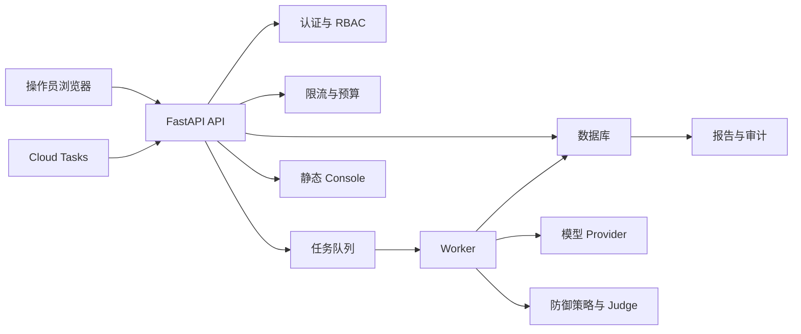

# proj4 威胁模型：LLM/RAG 安全评测平台

## 执行摘要

本威胁模型将 `proj4` 定位为“内部 LLM/RAG 安全评测与防御策略对比平台”，而不是公网生产级安全网关。当前系统已经具备 `RBAC`、`OIDC`、审计日志、token 预算、Redis 限流降级、raw/delivered 结果分离等安全控制；最高风险集中在四类边界：API 权限与租户隔离、Cloud Tasks 回调与任务执行、模型/数据输出中的敏感信息、Console 前端对后端返回内容的 DOM 渲染。

面试时可以把这份文档作为“我知道系统不该做什么”的证据：它能说明项目具备安全工程意识，但不应夸大为已经完成真实企业长期红队、SOC2 或生产 SLA 验证。

## 审查范围与假设

### 本次纳入范围的代码路径

- `llm_security_platform/app/api.py`
- `llm_security_platform/app/security.py`
- `llm_security_platform/app/middleware.py`
- `llm_security_platform/app/task_queue.py`
- `llm_security_platform/app/tasks.py`
- `llm_security_platform/app/production_store.py`
- `llm_security_platform/app/cost_guardrail.py`
- `llm_security_platform/app/providers.py`
- `llm_security_platform/web/`
- `llm_security_platform/docker-compose.yml`
- `.github/workflows/cloud_ci_cd.yml`
- `scripts/cloud_e2e_smoke_test.py`

### 本次不纳入范围

- 不对真实 GCP 项目做在线渗透测试。
- 不证明生产 SLA、SOC2、长期红队效果或真实 ROI。
- 不在本文中修复所有发现项；本文是审查材料和面试证据材料。

### 基本假设

- 系统主要面向内部 AI 平台、安全或研发团队。
- 默认部署路径是本地 Docker Compose 可复现；GCP Cloud Run/Cloud Tasks/GCS 是可部署路径。
- Console 演示使用 demo API key 或 JWT，不使用真实客户数据。
- 评测样本、模型响应、审计日志、报告可能包含敏感 prompt、泄露样本和 provider 元数据。

### 会改变风险排序的未决问题

- Cloud Run 服务是公网可访问，还是仅内网或身份代理可访问？
- 真实部署中是否允许存储第三方模型 API Key 或客户私有 RAG 文档？
- Console 是否会给非管理员角色长期使用，还是只作为演示/内部运维工具？

## 系统模型

### 主要组件

- FastAPI API：`api.py` 定义 `/cases`、`/datasets/import`、`/async-runs`、`/tasks/execute-run`、`/human-reviews`、`/audit-logs`、`/metrics`、`/ws` 等入口。
- 认证与权限：`security.py` 定义 `ROLE_PERMISSIONS`、`require_api_key`、`require_permission`、`verify_cloud_tasks_oidc`。
- 限流：`middleware.py` 使用 Redis 滑动窗口；Redis 故障时，写请求 fail-closed，读请求本地 fallback。
- 异步执行：`task_queue.py` 支持 Celery 和 Cloud Tasks；`tasks.py` 执行 run/case。
- 存储层：`production_store.py` 管理 PostgreSQL/SQLite 的 run、case、audit、tenant config；PostgreSQL 路径使用 `SET LOCAL search_path`。
- 成本保护：`cost_guardrail.py` 做 run/user/tenant token budget。
- 模型与防御：`providers.py`、`policy_engine.py`、`input_defense.py`、`rag_defense.py`、`output_defense.py`。
- 静态控制台：`web/index.html`、`web/app.js` 通过 `/console/` 挂载。

### 数据流与信任边界

- Browser/Operator -> FastAPI API  
  数据：API key/JWT、评测参数、case ids、dataset JSON、多模态 base64。控制：`X-API-Key`/JWT、RBAC、Pydantic schema、Redis rate limit。

- FastAPI API -> PostgreSQL/SQLite  
  数据：run metadata、case result、audit logs、tenant config。控制：tenant id、`SET LOCAL search_path`、query filters、schema constraints。

- FastAPI API -> Redis/Celery  
  数据：run id、tenant id、trace id、rate-limit counters、budget counters。控制：TTL、budget reconciliation、task state。

- Cloud Tasks -> `/tasks/execute-run`  
  数据：run id、tenant id、trace id。控制：仅 `LLM_SECURITY_QUEUE_MODE=cloud` 时启用；使用 Google OIDC audience/service account 校验。

- Worker -> Model Provider  
  数据：system prompt、user prompt、RAG context、model config。控制：provider adapter、timeout、circuit breaker、budget guardrail。

- Worker/API -> Report/GCS fallback  
  数据：安全报告、模型响应、审计证据。控制：本地 fallback；GCS IAM 仍需在真实云端验证。

- API -> Static Console  
  数据：run/case/report/audit JSON。控制：Console 请求携带 `X-API-Key`；前端仍需防 DOM XSS。

## 总体数据流图

## 关键资产与安全目标

| 资产 | 为什么重要 | 安全目标 |
|---|---|---|
| API keys 与 JWTs | 可伪造身份、跨租户读取 run/report | 机密性、完整性 |
| Tenant id 与 role claims | 决定 RBAC 与 schema routing | 完整性 |
| Evaluation prompts 与 model responses | 可能包含攻击样本、系统提示、敏感输出 | 机密性、完整性 |
| Audit logs | 安全证据链，不能被伪造或跨租户读取 | 机密性、完整性 |
| Token budgets 与 cost counters | 防止模型调用成本失控 | 完整性、可用性 |
| Redis/Celery/Cloud Tasks | 决定异步任务可用性与幂等性 | 可用性、完整性 |
| Provider credentials | 泄露后可能造成模型 API 滥用和账单风险 | 机密性、完整性 |
| Reports 与 GCS fallback files | 保存完整攻击和响应证据 | 机密性、完整性 |
| Console DOM | 展示不可信模型/样本内容，存在 XSS 风险面 | 机密性、完整性 |

## 攻击者模型

### 攻击者能力

- 低权限内部用户：持有 viewer/analyst/reviewer 之一的 key 或 JWT。
- 恶意租户：尝试通过 run_id、tenant_id、dataset 或 prompt 访问其他租户数据。
- 外部网络攻击者：如果服务暴露到公网，尝试未授权访问 API、OpenAPI、Console、Cloud Tasks webhook。
- Prompt/RAG 攻击者：构造恶意样本或 RAG 文档，诱导模型泄露信息。
- 供应链/CI 攻击者：尝试通过依赖、workflow、环境变量影响构建或部署。

### 默认不假设的能力

- 默认不假设攻击者拥有主机 shell、数据库管理员权限或 GCP 项目 Owner 权限。
- 默认不假设公网可直接访问 Cloud SQL/Redis。
- 默认不把 mock provider 的输出当成真实模型安全结论。

## 入口与攻击面

| 攻击面 | 访问方式 | 信任边界 | 说明 | 证据 |
|---|---|---|---|---|
| `/cases`, `/datasets/import` | HTTP API | Browser/API client -> API | 数据集导入可能携带恶意 prompt/metadata | `api.py:create_case`, `api.py:import_dataset` |
| `/async-runs` | HTTP API | User -> API -> Queue | 创建昂贵模型任务，涉及预算和幂等 | `api.py:create_async_evaluation` |
| `/tasks/execute-run` | Cloud Tasks HTTP push | Cloud Tasks -> API | 需要 OIDC 与 cloud mode | `api.py:execute_run_task`, `security.py:verify_cloud_tasks_oidc` |
| `/human-reviews` | HTTP API | Reviewer -> API/DB | 人审结论影响数据闭环 | `api.py:human_reviews`, `api.py:update_human_review` |
| `/audit-logs` | HTTP API | Reviewer/Admin -> API/DB | 审计数据敏感 | `api.py:audit_logs` |
| `/metrics` | HTTP API | Audit role -> API | 监控信息可能泄露运行状态 | `api.py:metrics_endpoint` |
| `/console/` | StaticFiles | Browser -> static app | 前端渲染后端 JSON | `api.py` StaticFiles mount, `web/app.js` |
| `/ws` | WebSocket | Browser -> API | token query 参数，run read 权限 | `api.py:websocket_endpoint` |
| Provider adapters | Worker -> external APIs | Worker -> model vendor | prompts/outputs/cost metadata | `providers.py` |
| GCS/local fallback | API/Worker -> storage | service -> filesystem/cloud | 报告含敏感证据 | `gcs_store.py`, `docs/cloud_e2e_smoke_test.md` |

## 重点滥用路径

1. 攻击者拿到低权限 key -> 枚举 run_id -> 访问 `/async-runs/{run_id}` -> 如果 tenant 过滤缺陷存在，则读取其他租户报告。
2. 攻击者构造恶意 dataset -> Console 使用 `innerHTML` 渲染未完全转义字段 -> 触发 DOM XSS -> 窃取 API key 输入框内容。
3. 攻击者绕过 Cloud Tasks OIDC -> 调用 `/tasks/execute-run` -> 执行任意 run 或重复消耗计算资源。
4. 攻击者提交大量 async run -> Redis 或 budget 失效 -> 模型调用成本和 worker 资源被耗尽。
5. 攻击者在 RAG 文档中放置指令注入 -> 模型 raw response 泄露机密 -> 如果 output defense/Judge/human review 失效，delivered response 暴露给用户。
6. 攻击者利用 query token export URL -> token 出现在浏览器历史、代理日志或 referer -> 后续复用读取报告。
7. 攻击者污染 metrics/logs/report metadata -> 误导安全运营判断或掩盖真实失败。
8. CI/CD 或 Terraform secret 配置不当 -> 云端服务使用默认/过宽权限 -> GCS、Cloud Tasks 或 API 被越权调用。

## 威胁清单

| 威胁编号 | 威胁来源 | 前置条件 | 威胁行为 | 影响 | 受影响资产 | 已有控制与证据 | 缺口 | 建议缓解措施 | 检测思路 | 可能性 | 影响等级 | 优先级 |
|---|---|---|---|---|---|---|---|---|---|---|---|---|
| TM-001 | 低权限内部用户 | 持有 viewer/analyst/reviewer key 或 JWT | 枚举 run/report/audit ids，尝试跨租户读取 | 租户数据泄露 | reports, audit logs, tenant data | `security.py` 中的 RBAC；`production_store.py` 中的 tenant filters；`SET LOCAL search_path` | 真实恶意租户长期验证不足 | 为每个 object access 增加 tenant ownership regression；统一 404/403 响应 | 按 actor/tenant 统计异常 404/403 | 中 | 高 | 高 |
| TM-002 | 恶意 dataset 或模型输出 | 能导入 case 或让模型输出 HTML-like content | 通过 Console `innerHTML` 渲染触发 DOM XSS | API key/JWT 泄露，审计数据被读 | API key, reports, Console DOM | 部分 evidence 使用 `escapeHtml` | `renderCases`, `loadRuns`, dashboard 多处拼接 HTML | 改为 DOM API/textContent，或集中 HTML escaping；增加 CSP header | CSP violation reports，前端错误日志 | 中 | 高 | 高 |
| TM-003 | 外部调用者 | Cloud Run/API 暴露且 queue mode 为 cloud | 伪造 Cloud Tasks webhook 或重放任务 | 任意任务执行、资源消耗 | task queue, compute, reports | `LLM_SECURITY_QUEUE_MODE=cloud`, `verify_cloud_tasks_oidc`, audience/service account checks | 需要真实云端 OIDC/IAM 验收日志 | 保存 Cloud Tasks push log；强制 service account allowlist | Cloud Logging 401/403/5xx on `/tasks/execute-run` | 低到中 | 高 | 高 |
| TM-004 | 已认证 analyst | 可创建 run | 提交大量 run/cases 或高 token config | 成本失控，worker 队列阻塞 | token budget, Redis, worker | `cost_guardrail.py`, Redis lock, case limit 100 | 预算与 provider 真实账单仍可能不一致 | 增加 per-tenant concurrent run cap；导出 budget metrics | budget rejects 与 queue depth 告警 | 中 | 中 | 中 |
| TM-005 | Prompt/RAG 攻击者 | 能控制 prompt 或 retrieved document | 间接注入诱导模型泄露或执行恶意指令 | raw compromise 或 delivered leakage | prompts, model responses, RAG docs | input/RAG/output defense, Judge, human review docs | 未证明覆盖全部未知攻击 | 保留 holdout、人工复核、raw/delivered 分离 | ASR, delivered ASR, benign refusal drift | 高 | 中 | 中 |
| TM-006 | 浏览器/日志观察者 | 用户点击 export with token query | token 出现在 URL、历史或日志 | 报告被复用读取 | API token, reports | Export route 仍检查 `run:read` | `?token=` transport 比 header 更易泄露 | 改为 header-based download 或短期一次性 export token | logs containing `token=` | 中 | 中 | 中 |
| TM-007 | 公网访问者 | API docs 或 Console 暴露 | 发现内部 endpoints，枚举攻击面 | 信息泄露和攻击效率提升 | API surface, schema | API auth on protected endpoints | FastAPI docs 默认可能暴露；Console static page 可访问 | prod 下禁用/保护 docs；Console 前置认证或网络限制 | access logs for `/docs`, `/openapi.json`, `/console` | 中 | 低到中 | 中 |
| TM-008 | CI/deployment actor | workflow/terraform secret 配置不当 | 扩大 IAM、泄露 secret、错误部署 | 云资源和报告泄露 | GCS, Cloud Run, Cloud Tasks, state | `.github/workflows/cloud_ci_cd.yml`, terraform configs | 真实云端 state/secret 生命周期未在本模型验证 | 最小权限、state 加密、secret rotation runbook | IAM change audit, GCS 403/ACL alerts | 低到中 | 高 | 中 |

## 严重性校准

- 严重：默认公网下可未授权执行任务、跨租户读取所有报告、泄露长期 provider/API 密钥。
- 高：低权限用户跨租户读写、人为绕过 Cloud Tasks OIDC、Console XSS 窃取 API key。
- 中：可制造明显成本/队列压力、泄露有限运行元数据、误导 metrics/report。
- 低：仅暴露非敏感版本信息，或需要本机访问/测试环境前提的低影响问题。

## 安全复查重点路径

| 路径 | 为什么重要 | 相关威胁编号 |
|---|---|---|
| `llm_security_platform/app/security.py` | JWT/API key/RBAC/OIDC 的核心边界 | TM-001, TM-003, TM-006 |
| `llm_security_platform/app/api.py` | 所有 HTTP/WebSocket 入口和权限依赖 | TM-001, TM-003, TM-007 |
| `llm_security_platform/app/production_store.py` | tenant routing、audit、run/case 状态 | TM-001, TM-004 |
| `llm_security_platform/app/middleware.py` | Redis 限流和 fail-closed 行为 | TM-004 |
| `llm_security_platform/app/cost_guardrail.py` | token/cost 预算控制 | TM-004 |
| `llm_security_platform/app/task_queue.py` | Celery/Cloud Tasks 调度与 OIDC payload | TM-003, TM-004 |
| `llm_security_platform/app/providers.py` | 外部模型调用、prompt 泄露和成本元数据 | TM-005 |
| `llm_security_platform/web/app.js` | Console DOM XSS 和 token 暴露风险 | TM-002, TM-006 |
| `.github/workflows/cloud_ci_cd.yml` | 云端部署、身份令牌、smoke test | TM-008 |
| `llm_security_platform/terraform/` | Cloud Run/Tasks/GCS/SQL 权限与网络边界 | TM-008 |

## 使用说明

- 本文适合面试展示“我知道系统不该做什么”：它不是生产安全网关，也不承诺 100% 防御。
- 高优先级不等于校招项目必须立刻全部修完；对内部试点而言，最有价值的是能解释风险、已有控制和证据边界。
- 如果要进入真实云端试点，应补充脱敏 Cloud Run URL、Cloud Tasks push 日志、GCS 归档记录和 IAM 最小权限审计。
