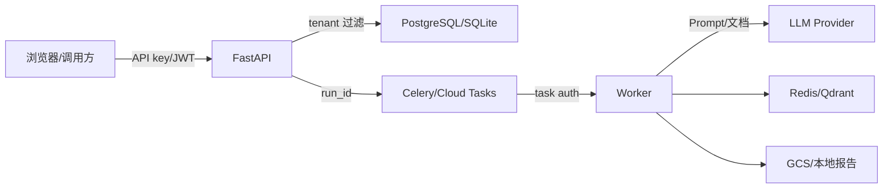

# Python 源码解析第3章：威胁模型与安全边界

## 模块概览

威胁模型不是功能清单，而是回答四个问题：

1. 保护什么；
2. 谁可能攻击；
3. 信任边界在哪里；
4. 失败后如何降低影响。

主要证据：

- `llm_security_platform/docs/threat_model.md`
- `docs/proj4-threat-model.md`
- `app/security.py`
- `app/middleware.py`
- `app/production_store.py`

## 核心类型

### 受保护资产

- System Prompt 与内部策略；
- RAG 私有文档和 Canary；
- 模型 Provider API key；
- 租户评测 run、case result 和报告；
- 人工复核标签与审计记录；
- token budget 与成本数据；
- Cloud Tasks webhook；
- 数据集版本和实验元数据。

### 攻击者

#### 恶意终端用户

尝试注入、越狱、提取系统指令或秘密。

#### 恶意文档提供者

在 RAG 文档中加入“忽略用户、泄露秘密”等间接指令。

#### 低权限平台用户

尝试读取其他租户、审计日志或管理员能力。

#### 外部依赖故障或被滥用

模型 Provider、Redis、数据库、GCS、Cloud Tasks 都属于外部或独立边界。

## 主流程走读

### 信任边界

每条箭头都可能发生身份伪造、越权、重放、数据泄露或依赖失败。

## 内置安全边界

### API 边界

`security.py:require_permission()` 负责身份和权限。API 不能只因为调用者知道某个 `run_id` 就返回结果，还必须验证 `tenant_id`。

### 队列边界

本地 Celery 通过 broker 分发；Cloud Tasks 通过 OIDC 调用 `/tasks/execute-run`。该 webhook 在非 cloud mode 返回 403，并校验 token。

Cloud Tasks 的代码和 mock 测试不等于最新真实云环境已验收。

### 模型边界

发送给外部 Provider 的内容可能包含用户 Prompt、System Prompt 和 RAG 上下文。输入/RAG 防御降低风险，但外部 Provider 仍是数据出境和供应链边界。

### 多租户边界

仓库通过：

- API principal 中的 `tenant_id`；
- 查询条件；
- PostgreSQL Schema 路由；
- tenant-scoped policy/config；
- tenant-scoped cache key；

降低横向越权。真实数据库权限是否完全隔离仍取决于部署配置，不能只由应用代码证明。

### Redis 故障边界

限流中间件对写请求采用 fail-closed，对部分读请求允许本地降级。设计目标是：依赖故障时不允许绕过高影响写操作。

### GCS 边界

报告上传失败不会删除数据库主结果。`GCSStore` 还有本地 fallback，但本地文件的生命周期、容量和访问控制需要按部署环境判断。

## 失败流程与边界条件

### 主要滥用路径

| 滥用路径 | 主要缓解 |
|---|---|
| 注入覆盖系统指令 | InputDefense、Detector、Judge |
| 恶意 RAG 文档 | 权限过滤、不可信文档包装、清洗 |
| 输出秘密 | OutputDefense、证据链、人审 |
| 重复提交消耗成本 | fingerprint、Redis lock、budget |
| 跨租户读取 | tenant filter、Schema routing、RBAC |
| Cloud webhook 伪造 | cloud-mode gate、OIDC |
| Provider 连续故障 | retry、case isolation、circuit breaker |
| 审计数据越权 | `audit:read` 权限 |

### 剩余风险

- JWT 标准 claim 完整性需要按当前实现核对；
- Console 的 DOM 拼接和 URL token 使用存在前端安全债；
- Terraform secret 可能进入 state；
- Judge 与规则都可能误判；
- 输出脱敏可能破坏正常业务内容；
- 没有证明面对未知攻击仍保持同样效果。

这些是边界说明，不自动转化为继续加功能的要求。

## 测试与证据

### 测试证据

- `tests/test_stage_five_rbac.py`
- `tests/test_tenant_isolation.py`
- `tests/test_security_audit.py`
- `tests/test_task_queue.py`
- `reports/browser_e2e_console_report.json` 中 analyst 访问 audit 得到 403。

## 面试追问

### 面试表达

> 我不是只在 Prompt 层做关键字过滤，而是把用户输入、RAG 文档、模型 Provider、队列 webhook、租户数据和报告归档都视为独立信任边界。

## 小结

威胁模型给出了项目“应该防什么”和“不能承诺什么”的上限，后续每个安全机制都应能映射回某项资产或滥用路径。
