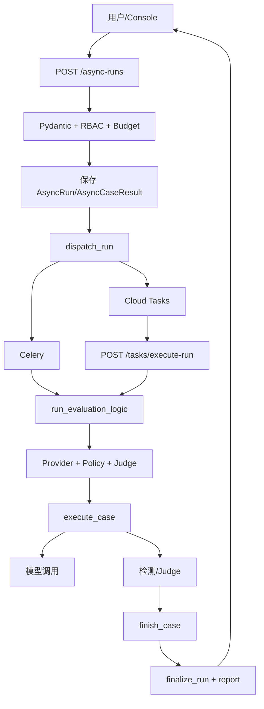

# Python 源码解析第4章：总体架构与端到端数据流

## 模块概览

### 分层架构

| 层 | 主要文件 | 职责 |
|---|---|---|
| Console | `web/index.html`、`web/app.js` | 创建 run、轮询、展示 case 和报告 |
| API | `app/api.py` | 路由、Schema、权限、审计 |
| 调度 | `app/async_jobs.py`、`app/task_queue.py` | Celery/Cloud Tasks 分发 |
| Worker | `app/tasks.py` | 恢复配置、并发执行、完成 run |
| Case pipeline | `app/case_execution.py` | 防御、模型、检测、Judge |
| Provider | `app/providers.py` | 模型 SDK 适配 |
| Policy | `policies/` | input/RAG/output 防御 |
| Detection | `app/detectors.py`、`app/judge.py` | 规则、语义、Judge |
| Store | `app/production_store.py` | run/case/audit/tenant 持久化 |
| Operations | `app/metrics.py`、`app/tracing.py` | 指标、trace、日志 |

## 核心数据流

### 总体调用图



## 主流程走读

### 创建异步 Run

`api.py:create_async_evaluation` 依次执行：

1. `run:create` 权限；
2. 预算预检查；
3. case 数量和存在性检查；
4. 请求 fingerprint；
5. Redis 去重锁；
6. 保存 run 和 case；
7. 分发任务；
8. 写审计；
9. 返回 202。

先持久化再投递，确保 Worker 只需要 `run_id` 就能恢复上下文。

### Worker 初始化

`tasks.py:run_evaluation_logic`：

1. 恢复 trace；
2. 根据 run 恢复真实 tenant；
3. 再次校验请求 JSON；
4. 注入 tenant key；
5. 构建 Provider；
6. 构建 PolicyEngine；
7. 构建 Judge。

初始化失败会 `fail_run()`，而不是让 run 永久停留在 PENDING。

### 单 Case 数据流

```text
AttackCase
→ DefenseContext
→ before_model
→ SemanticCache/CircuitBreaker/Budget
→ Provider.generate
→ after_model
→ raw_detector + delivered detector
→ Judge
→ evidence_chain
→ AsyncCaseResult
```

### 人工复核流

```text
LayeredAssessment/Judge 不确定
→ HumanReviewItem
→ reviewer 完成标签
→ agreement metrics
→ 可选 promote-to-dataset
```

这形成“评测—复核—样本回流”闭环，但真实标注者规模和长期数据质量仓库中未验证。

### 查询与报告流

`GET /async-runs/{run_id}` 同时返回：

- `run`
- `report`
- `cases`

报告由数据库中的 case 结果重新聚合，不依赖浏览器内存。

## 内置执行路径

### 同步与异步路径

`POST /runs` 使用 `app/evaluator.py` 的同步路径，适合离线和开发验证；`POST /async-runs` 使用持久化状态与队列，是项目展示的主要工程链。

两条路径共享 Provider、策略和指标概念，但实现并非完全同一个函数，面试时应说明。

### 默认与扩展路径

默认产品路径：

- cases/datasets；
- async runs；
- Provider；
- Policy；
- Judge；
- case persistence；
- report/console。

扩展轨道：

- content safety；
- Crescendo；
- multimodal；
- semantic classifier；
- Envoy simulator。

扩展模块存在不代表默认 run 自动覆盖所有能力。

## 关键机制与设计取舍

### 架构取舍

- 模块化单体：便于校招项目理解和部署；
- API/Worker 分进程：隔离长任务；
- 显式工厂：可审计，扩展性不如插件注册；
- JSON 结果：保存证据方便，Schema 演进要谨慎；
- 线程池：适合 I/O 并发，不适合 CPU 推理。

## 失败流程与边界条件

### 失败流

| 失败点 | 行为 |
|---|---|
| 无 case | API 400 |
| 重复请求 | API 409 |
| 队列失败 | run fail + API 503 |
| Worker 初始化失败 | `fail_run` |
| 单 case 失败 | case FAILED，其他 case 继续 |
| budget exceeded | 请求取消后续执行 |
| GCS 上传失败 | 记录日志，数据库结果保留 |

## 测试与证据

- 浏览器 E2E：`reports/browser_e2e_console_report.json`
- Docker E2E：`llm_security_platform/reports/stage_5_5_docker_e2e.json`
- 故障演练：`stage_5_6_fault_drill.json`

这些产物证明记录环境中的链路，不证明生产规模和长期稳定性。

## 面试追问

### 为什么没有直接拆成大量微服务？

当前规模下，模块化单体加独立 Worker 已能隔离长任务，并保持本地复现和读码成本可控。真正拆微服务还会增加服务发现、分布式事务和运维成本，仓库没有需要强行拆分的证据。

### 这是不是 Agent 架构？

不是。主链路由代码确定执行顺序，模型不会自主选择工具、修改工作流或创建 SubAgent；它是安全评测工作流。

## 小结

项目主线是一个确定性的安全评测工作流，而不是由模型自由规划的 Agent。工程亮点在于把长任务、失败状态、证据和报告串成闭环。
