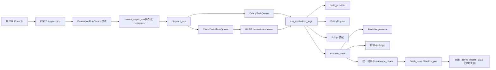
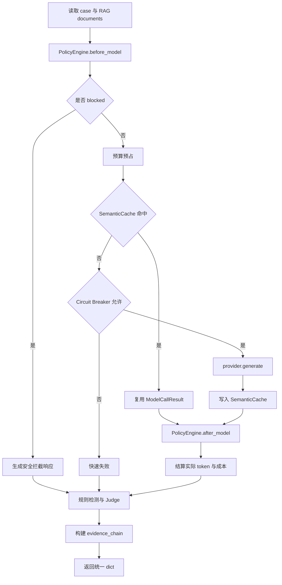

# Python 源码解析第11章：组件选择、任务分发与评测执行框架

> 这篇文章沿着“工具注册与执行框架”的阅读方式，解释 `proj4` 如何选择模型 Provider、防御策略、Judge 和任务队列，并把一次安全评测拆成可持久化、可恢复、可审计的执行链。
>
> 先说明边界：本项目没有 Agent Runtime 中的 `Tool Registry`、`Tool Schema`、`tool_use` 流式解析，也没有 `ReadFile / WriteFile / Bash` 这类可由模型自主调用的工具。仓库中与“注册和执行”最接近的真实实现，是**显式工厂 + 抽象接口 + 配置选择 + Worker 编排**。面试时应称为“评测组件装配与异步执行框架”，不要称为“通用 Agent 工具框架”。

## 模块概览

核心代码集中在以下文件：

| 文件 | 职责 |
|---|---|
| [`app/schemas.py`](../../llm_security_platform/app/schemas.py) | 定义 API 请求、检测结果、防御决策和报告结构 |
| [`app/providers.py`](../../llm_security_platform/app/providers.py) | 定义统一 Provider 接口、各模型适配器和 `build_provider()` |
| [`app/task_queue.py`](../../llm_security_platform/app/task_queue.py) | 定义 `BaseTaskQueue`，在 Celery 与 Cloud Tasks 之间切换 |
| [`app/async_jobs.py`](../../llm_security_platform/app/async_jobs.py) | 为 API 提供稳定的 `dispatch_run()` 入口 |
| [`app/tasks.py`](../../llm_security_platform/app/tasks.py) | Worker 主编排：重建组件、并发 case、落库、归档报告 |
| [`app/case_execution.py`](../../llm_security_platform/app/case_execution.py) | 单个 case 的防御、模型、检测、Judge 和证据链 |
| [`policies/policy_engine.py`](../../llm_security_platform/policies/policy_engine.py) | 解析并按固定顺序装配 input/RAG/output 防御策略 |
| [`app/judge.py`](../../llm_security_platform/app/judge.py) | `LLMJudge` 与 `RuleBackedJudge` 的统一判定入口 |
| [`app/production_store.py`](../../llm_security_platform/app/production_store.py) | run/case 状态、attempts、结果和报告的持久化 |
| [`app/api.py`](../../llm_security_platform/app/api.py) | `/async-runs`、`/tasks/execute-run` 和查询/导出接口 |

这些模块构成了一条明确的调用链：



这个框架的核心不是“模型自己挑工具”，而是系统根据经过校验的配置，在 Worker 启动时装配确定性组件。

## 核心类型

#### `ModelProvider`

位置：[`llm_security_platform/app/providers.py`](../../llm_security_platform/app/providers.py)

所有模型适配器实现同一个抽象接口：

```python
class ModelProvider(ABC):
    name: str
    model: str

    @abstractmethod
    def generate(
        self,
        system_prompt: str,
        user_prompt: str,
    ) -> ModelCallResult:
        raise NotImplementedError
```

上层执行器只依赖 `generate()`，不直接依赖 OpenAI、Ollama、Gemini 或 Vertex SDK。这样做的价值有三点：

1. `execute_case()` 不需要为每个模型写一套分支。
2. 测试可以注入 `MockProvider` 或失败 Provider。
3. Provider 可以统一返回 token、成本和调用元数据。

它是典型的 Adapter + Strategy 组合，但仓库没有动态插件发现机制。

#### `ModelCallResult`

位置：[`llm_security_platform/app/providers.py`](../../llm_security_platform/app/providers.py)

```python
@dataclass
class ModelCallResult:
    response_text: str
    token_usage: dict[str, int] = field(default_factory=dict)
    estimated_cost: float = 0.0
    provider_metadata: dict = field(default_factory=dict)
```

`ModelCallResult` 把不同 SDK 的响应统一成四类数据：

- `response_text`：原始模型文本；
- `token_usage`：prompt、completion 和 total token；
- `estimated_cost`：按 Provider 配置估算的调用成本；
- `provider_metadata`：响应 ID、延迟、finish reason、缓存命中等扩展信息。

这相当于截图中 `ToolResult` 的角色：它不抛弃供应商差异，但为上层提供稳定结果结构。

#### `BaseTaskQueue`

位置：[`llm_security_platform/app/task_queue.py`](../../llm_security_platform/app/task_queue.py)

```python
class BaseTaskQueue(ABC):
    @abstractmethod
    def enqueue(
        self,
        run_id: str,
        tenant_id: str = "default",
        trace_id: str | None = None,
    ) -> str:
        pass
```

它统一了任务分发入口。API 只关心 `run_id` 能否进入执行系统，不关心背后是：

- Celery 的 broker pull 模式；
- Google Cloud Tasks 的 HTTP push 模式。

返回值是任务 ID 或 Cloud Tasks 完整 task name，随后写入 run 记录，便于追踪。

#### `DefenseExecution`

位置：[`llm_security_platform/policies/policy_engine.py`](../../llm_security_platform/policies/policy_engine.py)

```python
@dataclass
class DefenseExecution:
    system_prompt: str
    user_prompt: str
    response_text: str = ""
    blocked: bool = False
    review_required: bool = False
    decisions: list[DefenseDecision] = field(default_factory=list)
```

它记录一次 case 在防御链中的中间状态：

- 输入是否被改写；
- RAG 文档是否被清洗；
- 是否提前拦截；
- 输出是否被脱敏；
- 是否需要人工复核；
- 每一步产生了什么 `DefenseDecision`。

这使得防御不只是一个布尔值，而是一串可审计决策。

#### `EvaluationRunCreate`

位置：[`llm_security_platform/app/schemas.py`](../../llm_security_platform/app/schemas.py)

`EvaluationRunCreate` 是组件装配的配置入口，主要字段包括：

```python
class EvaluationRunCreate(BaseModel):
    name: str
    provider: Literal["mock", "ollama", "openai_compatible"] = "mock"
    model: str | None = None
    defense_policy: str = "none"
    case_ids: list[str] = Field(default_factory=list)
    versions: dict[str, str] = Field(default_factory=dict)
    inference_config: dict[str, Any]
    defense_config: dict[str, Any]
    judge_provider: Literal[
        "mock", "ollama", "openai_compatible", "disabled"
    ] = "mock"
    concurrency: int = Field(default=1, ge=1, le=8)
```

它决定：

- 被测模型使用哪个 Provider 和 model；
- 是否启用 input/RAG/output 防御；
- 跑哪些攻击样本；
- Judge 用规则模拟、真实模型还是关闭；
- 单批并发度是多少。

注意：`build_provider()` 的实现还包含 `vertexai` 和 `gemini` 分支，但当前 `EvaluationRunCreate.provider` 的 API Schema 只允许 `mock`、`ollama`、`openai_compatible`。因此 Vertex/Gemini 属于**代码中已有适配实现，但当前默认 run API 未验证可直接选择的能力**，面试中不能说所有 Provider 都已通过同一公开请求模型完整开放。

## 主流程走读

#### 第一步：API 接收并校验评测请求

位置：`api.py:create_async_evaluation`

用户调用：

```http
POST /async-runs
```

请求先经过：

1. `require_permission("run:create")` 权限校验；
2. `EvaluationRunCreate` Pydantic 校验；
3. tenant/user/run 预算预检查；
4. 单次 case 数量不超过 100；
5. 根据 `case_ids` 查找租户可见攻击样本；
6. 无可用 case 时返回 `400`。

这一步说明“组件选择字符串”并不是直接进入 Worker，而是先受 API Schema 和权限边界约束。

#### 第二步：先持久化 run，再投递任务

API 计算请求指纹：

```python
fingerprint = get_run_fingerprint(
    request,
    request.case_ids,
)
```

若 Redis 可用，则用：

```text
run_lock:{tenant_id}:{fingerprint}
```

作为 300 秒的 `SET NX EX` 分布式锁，拦截重复提交。

随后 `create_async_run()` 一次写入：

- `AsyncRun`；
- 该 run 对应的所有 `AsyncCaseResult` 初始记录；
- 请求配置；
- dataset/policy/code 版本；
- 指纹和锁 key。

只有数据库记录成功后才执行 `dispatch_run()`。这意味着队列中只传轻量 `run_id`，完整请求和 case 数据由 Worker 从数据库重建。

这种顺序有两个好处：

1. 即使 API 进程退出，任务上下文仍在数据库中；
2. Worker 重试时不依赖原 HTTP 请求对象。

#### 第三步：Celery 或 Cloud Tasks 分发

##### Celery

`CeleryTaskQueue.enqueue()` 调用：

```python
execute_evaluation_run.delay(
    run_id,
    tenant_id=tenant_id,
    trace_id=trace_id,
)
```

Celery 返回 task ID，系统通过 `set_task_id()` 写回 run。

##### Cloud Tasks

`CloudTasksTaskQueue.enqueue()` 构造 HTTP task：

```text
POST {LLM_SECURITY_WORKER_SERVICE_URL}/tasks/execute-run
```

payload 仅包含：

```json
{
  "run_id": "run123",
  "tenant_id": "tenant123",
  "trace_id": "trace123"
}
```

若配置 `LLM_SECURITY_TASKS_SERVICE_ACCOUNT`，task 会附加 OIDC token。

Cloud task name 使用：

```text
.../tasks/{run_id}
```

当 Google 返回 `AlreadyExists` 时，代码把它视为重复投递并返回原 task name，而不是再次创建。

这实现的是“同一个 run 的分发幂等”，不是任意业务操作的全局 exactly-once。

#### 第四步：Worker 重建运行组件

位置：`tasks.py:run_evaluation_logic`

Worker 根据 `run_id`：

1. 设置 `trace_id` 上下文；
2. 查询 `AsyncRun`；
3. 恢复真实 `tenant_id`；
4. 读取 `request_json`；
5. `EvaluationRunCreate.model_validate(payload)` 再次校验；
6. 注入租户级模型 key；
7. 构建 Provider；
8. 构建 `PolicyEngine`；
9. 构建 Judge。

组件不是在 API 进程中构建后序列化进队列，而是在 Worker 端根据持久化配置重建。这避免了 SDK client、网络连接和密钥对象跨进程序列化的问题。

初始化失败时：

```python
fail_run(
    run_id,
    f"worker initialization failed: {exc}",
)
```

run 会进入失败状态，然后异常继续抛出，让任务系统感知失败。

#### 第五步：批量并发执行 case

Worker 调用：

```python
remaining = pending_cases(run_id)
```

只取未完成 case。随后按 `request.concurrency` 分批：

```python
for offset in range(
    0,
    len(remaining),
    request.concurrency,
):
    ...
```

每个 batch 使用：

```python
ThreadPoolExecutor(
    max_workers=request.concurrency
)
```

并发执行 `execute_case()`。

在提交线程前，`begin_case()` 会：

- 跳过已完成 case；
- 把状态改为 `RUNNING`；
- `attempts += 1`；
- 清理旧 error；
- 写入开始时间。

因此恢复执行时，不必重跑已经 `COMPLETED` 的 case。

#### 第六步：单 case 执行安全流水线

位置：`case_execution.py:execute_case`

完整顺序如下：



关键点：

- 防御链先处理输入和 RAG，再调用模型；
- 输出防御处理原始响应，但同时保留 `raw_response_text`；
- `raw_detector` 衡量模型原始失陷；
- `detector` 衡量最终交付结果是否仍然失陷；
- Judge 读取原始响应，用于独立判定；
- `evidence_chain` 保存输入检测、防御决策、有效输入、原始输出、规则判定、Judge 和人工复核槽位。

这正是安全评测与普通聊天接口的区别：系统不只返回一句答案，还要保留“为什么判定成功或失败”的证据。

#### 第七步：结果落库与报告生成

每个 future 完成后：

```python
finish_case(
    run_id,
    case_id,
    result=result,
)
```

异常则：

```python
finish_case(
    run_id,
    case_id,
    error=str(exc),
)
```

单 case 失败不会自动丢弃整次 run。Worker 在所有批次结束后调用：

```python
status = finalize_run(run_id)
```

随后：

1. `build_async_report()` 汇总攻击成功率、原始失陷率、误报率、延迟、token 和成本；
2. `gcs_store.upload_json()` 尝试归档；
3. 释放 Redis 分布式幂等锁；
4. 返回 run 最终状态。

GCS 归档失败只记录错误，不反向改写已经完成的数据库结果。这属于“主结果优先、外部归档降级”的取舍。

## 内置组件与选择

### 组件“注册”与选择

#### Provider：显式工厂，不是动态 Registry

位置：`providers.py:build_provider`

源码采用显式 `if/elif` 工厂：

```python
def build_provider(provider, model=None, model_config=None):
    if provider == "mock":
        raw = MockProvider(...)
    elif provider == "ollama":
        raw = OllamaProvider(...)
    elif provider == "vertexai":
        raw = VertexAIProvider(...)
    elif provider == "gemini":
        raw = GeminiProvider(...)
    elif provider == "openai_compatible":
        raw = OpenAICompatibleProvider(...)
    else:
        raise ModelProviderError(
            f"Unsupported provider: {provider}"
        )

    return CircuitBreakerProviderWrapper(raw)
```

它做了三件事：

1. 根据字符串选择实现类；
2. 注入 model、API key、base URL 和推理配置；
3. 统一套上 `CircuitBreakerProviderWrapper`。

这种设计的优点是控制流直观、便于审计，不会在运行时扫描任意模块。代价是增加 Provider 时必须同时修改工厂和请求 Schema，不像插件 Registry 那样可动态扩展。

面试时可以这样说：

> 我把模型 SDK 差异收敛到 `ModelProvider.generate()`，通过显式工厂装配。安全评测平台优先要可控和可审计，所以没有做自动插件发现；新增 Provider 需要显式代码和 Schema 变更。

#### Queue：模块加载时根据环境选择

位置：`task_queue.py`

```python
queue_mode = os.environ.get(
    "LLM_SECURITY_QUEUE_MODE",
    "local",
).lower()

if queue_mode == "cloud":
    task_queue = CloudTasksTaskQueue()
else:
    task_queue = CeleryTaskQueue()
```

`async_jobs.dispatch_run()` 再把这个全局选择封装起来：

```python
def dispatch_run(run_id, tenant_id="default", trace_id=None):
    from llm_security_platform.app.task_queue import task_queue
    return task_queue.enqueue(
        run_id,
        tenant_id=tenant_id,
        trace_id=trace_id,
    )
```

这是简单的环境驱动工厂：

- `local`：Celery worker 从 broker 拉取任务；
- `cloud`：Cloud Tasks 将带 OIDC 的 HTTP 请求推送到 Cloud Run。

需要注意，默认值虽然叫 `local`，实际实现仍是 `CeleryTaskQueue`，并不是当前进程内直接执行。

#### Policy：固定顺序装配

位置：`policies/policy_engine.py`

策略字符串可以写成：

```text
input_defense+rag_defense+output_defense
```

但真正的执行顺序由常量控制：

```python
POLICY_ORDER = (
    "input_defense",
    "rag_defense",
    "output_defense",
)
```

`parse_policy_bundle()` 会：

1. 把 `+` 和 `,` 统一为列表；
2. 拒绝不支持的策略名；
3. 按 `POLICY_ORDER` 重排，而不是相信用户输入顺序。

因此即使输入：

```text
output_defense+input_defense+rag_defense
```

最终仍会得到：

```python
[
    "input_defense",
    "rag_defense",
    "output_defense",
]
```

这是一项安全设计：输出脱敏必须在模型调用之后，输入和 RAG 清洗必须在调用之前，不能让配置顺序破坏安全语义。

`PolicyEngine._load_policy()` 同样采用显式映射：

```python
if name == "input_defense":
    return InputDefense(...)
elif name == "rag_defense":
    return RAGDefense(...)
elif name == "output_defense":
    return OutputDefense(...)
else:
    raise ValueError(...)
```

策略配置会按 `tenant_id + name + version` 从数据库读取；找不到记录时使用代码默认配置。

#### Judge：由 run 配置装配

位置：`tasks.py:run_evaluation_logic`

```python
if request.judge_provider == "disabled":
    judge = False
elif request.judge_provider == "mock":
    judge = RuleBackedJudge()
else:
    judge = LLMJudge(
        build_provider(
            request.judge_provider,
            request.model,
            request.inference_config,
        )
    )
```

这里有三个模式：

| 配置 | 实际行为 |
|---|---|
| `disabled` | 不执行 Judge，`judge_result=None` |
| `mock` | 使用 `RuleBackedJudge`，适合可重复离线测试 |
| 其他已允许 Provider | 使用 `LLMJudge`，内部再调用模型 Provider |

Judge 与被测 Provider 分开，是因为“生成答案”和“判定攻击是否成功”是两个职责。否则同一个模型既当运动员又当裁判，会放大偏差。

## 内置实现

#### 模型 Provider

| Provider | 入口 | 适用场景 | 证据边界 |
|---|---|---|---|
| `MockProvider` | `provider="mock"` | 可重复测试攻击、失败与超时 | 是测试模拟，不代表真实模型效果 |
| `OllamaProvider` | `provider="ollama"` | 本地模型 `/api/chat` | 需要本地 Ollama 与目标模型 |
| `OpenAICompatibleProvider` | `provider="openai_compatible"` | OpenAI-compatible API | 依赖有效 API key/base URL |
| `VertexAIProvider` | `build_provider("vertexai")` | Vertex AI SDK | 工厂已实现，但当前 run Schema 未开放该值 |
| `GeminiProvider` | `build_provider("gemini")` | Gemini Developer API 或 Vertex mode | 工厂已实现，但当前 run Schema 未开放该值 |

所有 Provider 最终由 `CircuitBreakerProviderWrapper` 包装。

#### 任务队列

| Queue | 触发方式 | 鉴权/幂等 | 适用证据 |
|---|---|---|---|
| `CeleryTaskQueue` | `.delay()` | Celery task ID；run/case 状态防重复完成 | 本地/Compose 异步路径 |
| `CloudTasksTaskQueue` | HTTP push | OIDC token；task name 使用 `run_id` | 单元测试验证 payload/OIDC/AlreadyExists |

真实 GCP 长期运行稳定性不能仅由 mock 单元测试证明；仓库内的 Cloud 文档和 smoke 产物应按其实际执行环境单独表述。

#### 防御策略

| Policy | 执行阶段 | 主要职责 |
|---|---|---|
| `InputDefense` | 模型调用前 | 识别覆盖指令等高风险输入，block/rewrite/review |
| `RAGDefense` | 模型调用前 | 过滤无权限文档、移除文档内命令、包装为不可信数据 |
| `OutputDefense` | 模型调用后 | secret redaction、攻击标记改写、人工复核路由 |
| `baseline` | 模型调用前 | 兼容旧版规则阈值与 system prompt hardening |

#### Judge

| Judge | 输入 | 输出 | 适用场景 |
|---|---|---|---|
| `RuleBackedJudge` | case + model response | `JudgeDecision` | 离线、稳定、可重复测试 |
| `LLMJudge` | case + model response + Judge Provider | `JudgeDecision` | 更复杂语义判定，但受模型偏差影响 |

`JudgeDecision` 使用 `extra="forbid"`，要求结构化字段齐全；如果攻击成功却没有证据引用，测试要求进入人工复核，而不是直接给出高置信结论。

## 关键机制

### 统一结果模型与 Schema

项目存在两层统一结果。

#### Provider 层

`ModelCallResult` 统一模型 SDK 响应。

#### 评测层

`execute_case()` 返回的主要字段包括：

```text
case_id
risk_type
status
original_prompt
effective_prompt
response_text
raw_response_text
detector
raw_detector
latency_ms
token_usage
estimated_cost
model_call
defense_decisions
review_required
evidence_chain
```

这里故意保留两组输出：

- `raw_response_text`：模型原始回答；
- `response_text`：经过 output defense 后最终交付的回答。

同理保留两组检测：

- `raw_detector`：原始模型是否失陷；
- `detector`：最终交付是否仍然失陷。

因此报告可以区分：

```text
模型本身被攻破
≠
最终用户收到危险内容
```

这比只统计一个“防御成功率”更可解释。

### 幂等、重试与恢复

#### API 提交去重

`create_async_evaluation()` 使用：

- 规范化请求 fingerprint；
- Redis `SET NX EX`；
- 数据库内活动 run fingerprint 二次检查。

Redis 不可用时，数据库检查仍能覆盖一部分重复请求，但不等于强分布式锁。

#### Queue 分发去重

Cloud Tasks 用 `run_id` 作为 task ID，并捕获 `AlreadyExists`。

Celery 路径本身不提供同样的任务名去重，主要依赖 API 指纹锁和数据库状态。

#### Worker 重入

`start_run()` 对已完成或取消 run 返回 `False`。

Cloud webhook 在发现 run 已处于：

```text
COMPLETED
FAILED
PARTIAL_FAILED
CANCELLED
```

时直接跳过。

#### case 恢复

`pending_cases()` 过滤 `COMPLETED`，`begin_case()` 再做一次状态检查并增加 `attempts`。

这支持从未完成 case 继续，但当前代码对失败 case 的自动重试次数、指数退避和死信队列没有形成一个统一的仓库内通用策略；不能把它表述为完整 exactly-once 或全自动故障恢复框架。

#### Provider 瞬态错误

`GeminiProvider` 对特定 `429/5xx/UNAVAILABLE` 错误做有上限的退避重试。

其他 Provider 主要把 SDK/HTTP 异常转换为 `ModelProviderError`，由 case 级失败隔离和熔断器处理。

#### 预算恢复

模型调用前预占 token，调用完成后按实际 token 结算；异常时在 `finally` 释放未使用预占量，避免失败调用永久占满预算。

## 失败流程与边界条件

### 错误分类

#### 1. 配置错误

示例：

- 不支持的 Provider；
- 不支持的 policy；
- 缺少 Cloud Tasks 必需环境变量；
- 缺少模型 API key。

处理方式：Worker 初始化失败，调用 `fail_run()`，异常上抛。

#### 2. 队列不可用

`dispatch_run()` 抛错时：

- run 被标记失败；
- Redis 锁尝试释放；
- API 返回 `503 task queue unavailable`。

#### 3. 单 case 模型失败

future 异常只把对应 case 标记为 `FAILED`，其他 case 继续执行。

#### 4. 熔断器打开

`execute_case()` 快速返回失败状态，不继续访问故障 Provider。

#### 5. 预算超限

case 错误包含 `BUDGET_EXCEEDED` 时，Worker 请求取消 run，避免后续 batch 继续消耗。

#### 6. 报告归档失败

GCS 上传异常只写日志，数据库中的 run/case 结果仍保留。

#### 7. Cloud webhook 重放

终态 run 直接返回 `skipped`；非终态再进入 `run_evaluation_logic()`。

## 测试与证据

### 测试证据

以下测试直接覆盖这篇文章所描述的组件与链路：

| 测试文件 | 已验证内容 |
|---|---|
| [`tests/test_task_queue.py`](../../llm_security_platform/tests/test_task_queue.py) | local/cloud queue 选择、Cloud Tasks payload、OIDC、task name、`AlreadyExists` |
| [`tests/test_defense_policies.py`](../../llm_security_platform/tests/test_defense_policies.py) | input block、RAG sanitize、output redact、policy 固定顺序 |
| [`tests/test_evaluator.py`](../../llm_security_platform/tests/test_evaluator.py) | Mock run、基线防御对比、单模型调用失败隔离 |
| [`tests/test_judge.py`](../../llm_security_platform/tests/test_judge.py) | 不可信证据边界、evidence quote、无证据时转人工复核 |
| [`tests/test_stage_five_store.py`](../../llm_security_platform/tests/test_stage_five_store.py) | 异步 run/case 的状态、失败与持久化 |
| [`tests/test_saas_idempotency_and_metering.py`](../../llm_security_platform/tests/test_saas_idempotency_and_metering.py) | 幂等与 token metering |

仓库测试通过数、Docker E2E、浏览器 E2E 和故障演练属于独立证据，应从 [`docs/interview_evidence_package.md`](../interview_evidence_package.md) 查看当前记录，不应把某个单元测试扩大成真实云稳定性结论。

## 能力边界

### 与 Agent Tool 框架的区别

| 维度 | 本项目 | 典型 Agent Tool 框架 |
|---|---|---|
| 选择者 | API 配置和 Worker 代码 | LLM 根据 Tool Schema 选择 |
| 注册方式 | `if/elif` 显式工厂 | Registry、装饰器或插件发现 |
| 输入结构 | `EvaluationRunCreate`、内部 Python 参数 | JSON Schema / Function Calling arguments |
| 执行对象 | Provider、Policy、Queue、Judge、case pipeline | 搜索、数据库、文件、命令等工具 |
| 运行步骤 | 预先定义、确定性顺序 | 可能多轮规划、调用和观察 |
| 循环控制 | run/case 状态和 batch | max steps、循环检测、tool result feedback |
| 权限重点 | tenant、RBAC、Cloud OIDC、评测数据 | 每个 tool 的最小权限和参数沙箱 |

可以安全地说：

> 项目实现了可配置的评测组件装配与异步执行框架，Provider、Queue、Policy 和 Judge 都有统一接口或统一选择入口。

不要说：

> 项目实现了完整 Tool Calling、MCP、多 Agent 协作或通用 Agent Runtime。

仓库中没有足够证据支持这些描述。

## 面试追问

#### 1. 为什么不用真正的动态 Registry？

回答思路：

> 当前 Provider 和 Policy 种类有限，而且属于安全评测关键路径。我选择显式工厂，让允许的实现、配置和包装顺序都能直接审计。代价是新增组件需要改工厂和 Schema；如果未来要做第三方插件生态，才有必要引入 Registry 和插件签名/权限机制。

#### 2. 为什么队列只传 `run_id`？

回答思路：

> SDK client、密钥和完整 case 不适合跨进程序列化。先把 run 和 case 持久化，队列只传 `run_id/tenant_id/trace_id`，Worker 再从数据库恢复配置，这样任务可追踪、可重入，也减少消息体大小。

#### 3. 为什么策略顺序不能由用户决定？

回答思路：

> input/RAG 防御必须在模型前，output 防御必须在模型后。用户输入顺序如果能改变安全语义，容易形成配置绕过，所以 `parse_policy_bundle()` 按固定 `POLICY_ORDER` 归一化。

#### 4. Provider 返回值为什么不能只返回字符串？

回答思路：

> 安全评测还需要 token、成本、响应 ID、延迟和缓存信息。统一 `ModelCallResult` 后，报告与成本护栏不依赖具体 SDK。

#### 5. 如何保证同一个任务不重复执行？

回答思路：

> API 层有 fingerprint + Redis 锁，数据库对活动 run 再检查；Cloud Tasks 用 `run_id` 做 task ID；Worker 和 webhook还检查终态，case 只重跑未完成项。但这是多层幂等保护，不是严格的分布式 exactly-once。

#### 6. 为什么使用 `ThreadPoolExecutor`？

回答思路：

> 单个 case 主要等待外部模型 I/O，线程池可以在有限并发下提高吞吐；`concurrency` 被 Schema 限制在 1 到 8，避免无限并发。它不是 CPU 密集型并行，也没有宣称自动扩缩到任意吞吐。

#### 7. 为什么 Judge 要单独装配？

回答思路：

> Provider 负责产生被测回答，Judge 负责判定攻击是否成功。分开后可以用规则 Judge 做确定性测试，也可以用独立模型做语义判定，并把不确定样本转给人工复核。

#### 8. 为什么同时有 `detector` 和 `raw_detector`？

回答思路：

> `raw_detector` 衡量模型原始失陷，`detector` 衡量经过输出防御后的最终交付风险。两者分开才能区分“模型被攻破”和“危险内容真正到达用户”。

#### 9. Cloud Tasks 路径已经生产验证了吗？

回答思路：

> 仓库可以证明 Cloud Tasks 的任务构造、OIDC 配置、重复 task 处理和 webhook 代码；是否存在最新真实云环境执行证据要以 smoke 报告和云日志为准。不能仅凭 mock 单测声称生产稳定性。

#### 10. 这个框架最明显的边界是什么？

回答思路：

> 它是内部安全评测工作流，不是通用 Agent Runtime，也不是生产流量网关。Provider/Policy 是显式工厂；某些 Provider 的实现和公开 API Schema 还不完全一致；重试与恢复是分层实现，不是通用工作流引擎。

## 小结

这套代码可以概括为：

```text
请求 Schema
→ 显式组件选择
→ run/case 先持久化
→ Celery 或 Cloud Tasks 分发
→ Worker 重建 Provider/Policy/Judge
→ 有限并发执行 case
→ 保留原始响应、最终响应和完整证据链
→ 状态落库、报告聚合与归档
```

它的亮点不是“模型能自主调用多少工具”，而是把一次 LLM/RAG 安全评测做成了可配置、可追踪、可恢复、可审计的后端执行流程。

最安全的项目表述是：

> 我实现了面向 LLM/RAG 安全评测的组件装配与异步执行框架，通过统一 Provider 接口、Celery/Cloud Tasks 队列抽象、有序防御策略、独立 Judge、case 级状态持久化和证据链结果模型，让批量攻击评测可以被复现、查询和审计。
