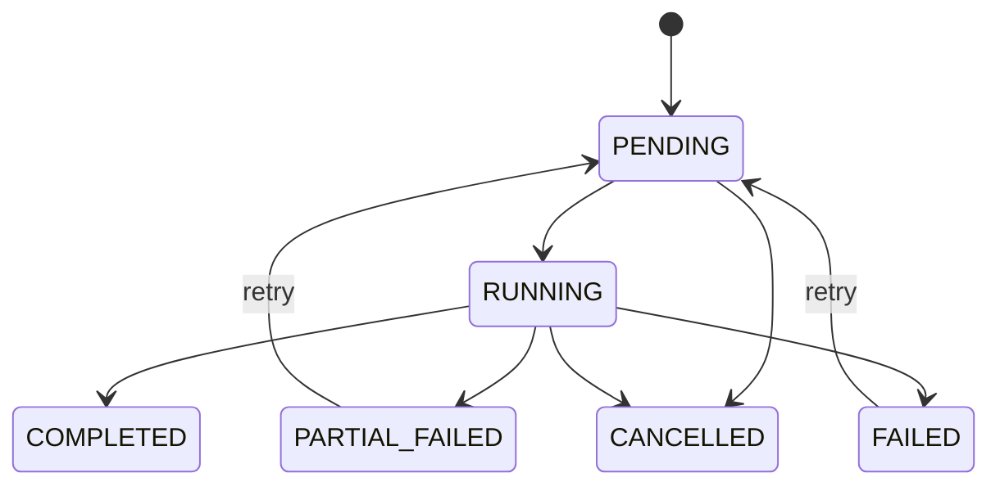

# Python 源码解析第13章：异步 Run 状态机

## 模块概览

### 状态对象

两个核心对象：

- `AsyncRun`：整个批次；
- `AsyncCaseResult`：单个样本。

run 状态由所有 case 的状态聚合，不依赖浏览器。

## 核心类型

### Run 状态



实际状态字符串以 `production_models.py` 和 `production_store.py` 当前实现为准。

## 主流程走读

### 创建

`create_async_run()` 同时保存 run 和全部 case 初始记录。状态默认为 PENDING，任务 ID在分发后补写。

### `start_run()`

- run 不存在：False；
- 已 COMPLETED/CANCELLED：False；
- 其他状态：设为 RUNNING；
- 保留首次 started time；
- 清理 completed time。

返回 False 时 Worker 可返回 `ignored`，用于重复投递保护。

### `pending_cases()`

筛选非 COMPLETED case。失败 case 在 retry 后仍可能进入待执行列表；已完成 case 不重复消耗模型。

### `begin_case()`

```text
检查 case
→ 已完成则跳过
→ status=RUNNING
→ attempts += 1
→ error=None
→ started_at=now
```

`attempts` 是恢复和重复执行诊断的重要字段。

### `finish_case()`

有 error 则 FAILED，否则 COMPLETED；保存结果或错误，再调用 `refresh_progress()`。

### `refresh_progress()`

重新查询所有 case，计算：

- success cases；
- failed cases；
- completed cases；
- progress。

它选择数据库重算而不是仅靠内存增量，减少 Worker 重启后的计数漂移。

### `finalize_run()`

- cancel requested：CANCELLED；
- 无失败：COMPLETED；
- 部分成功部分失败：PARTIAL_FAILED；
- 全部失败：FAILED。

### 取消

`request_cancel()` 设置标志。Worker 在 batch 之间检查，因此已经运行中的线程不会被强杀；取消是协作式，不是强制终止。

### 重试

`prepare_retry()`：

- 只允许特定终态；
- 重置 run 状态；
- 保留已完成 case；
- 增加 retry count；
- 再次入队。

### Stale Run

创建新 run 时如果发现相同 fingerprint 的活动 run，先判断其更新时间。超过阈值可标记旧 run FAILED，否则拒绝重复。

## 失败流程与边界条件

### 并发边界

状态更新通过独立 Session 完成，但严格的行锁/分布式事务语义需结合数据库隔离级别判断。仓库不能据此声称任意规模下无竞态。

## 测试与证据

### 故障证据

`stage_5_6_fault_drill.json` 记录：

- Worker 中断后恢复；
- duplicate delivery attempts 不增加；
- 单 case failure 得到 PARTIAL_FAILED；
- cancellation 得到 CANCELLED。

这是脚本控制的 Compose 故障演练证据，不是长期生产统计。

## 面试追问

### 面试回答

> 我没有把异步任务状态只放在 Celery backend，而是把 run/case、attempts、error 和 progress 持久化。Worker 重入时只取未完成 case。

## 小结

状态机是队列可靠性的基础。队列负责送达，数据库状态负责判断“应该执行什么、执行到哪里、是否已经完成”。
