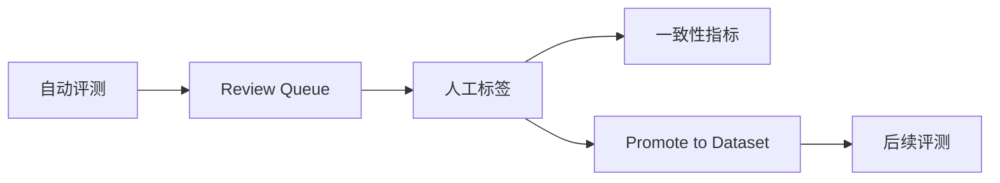

# Python 源码解析第23章：人工复核与数据回流闭环

## 模块概览

### 为什么必须有人审

安全判断存在：

- 规则与 Judge 冲突；
- Judge 无证据；
- 输出防御改变语义；
- 语义模型低置信；
- 高风险样本；
- 抽样质检。

默认自动化路径必须能承认不确定性。

## 核心类型

### Review Queue

`db.create_review_item()` 将需要复核的 assessment 保存为 pending item。

`GET /human-reviews` 需要 `review:read`。

## 主流程走读

### 完成复核

`PATCH /human-reviews/{review_id}` 接收：

```python
HumanReviewUpdate(
    human_final_label=...,
    human_attack_success=...,
    reviewer_note=...,
    reviewer=...,
)
```

路由需要 `review:write`，并写审计。

### 人工标签

人工结果包含：

- final outcome；
- attack success；
- reviewer；
- note；
- completed time。

Reviewer note 有最小长度，不能只点一个按钮而没有解释。

## 内置复核机制

### 一致性指标

`db.human_review_metrics()` 计算 Judge 与人工一致性。解释时必须说明：

- 分母是已复核样本；
- 样本可能被风险路由选择；
- 不是随机总体；
- 不代表 Judge 对所有 case 的准确率。

### Promote to Dataset

已完成 review 可通过：

```text
POST /human-reviews/{id}/promote-to-dataset
```

转成新 case。该接口检查状态和 tenant。

### 数据闭环



## 失败流程与边界条件

### 数据泄漏风险

Promote 后的样本若进入规则调优，就不能继续当原始 holdout。需要数据版本和冻结规则。

### Spot Check

除了冲突样本，系统可按 sample rate 抽取部分普通样本。抽样用于质量监测，不是完整标注。

### 权限边界

- analyst 可以创建 run；
- reviewer 才能完成复核；
- audit read 另有权限；
- tenant A reviewer 不应复核 tenant B item。

### 失败场景

- review ID 不存在；
- item 未完成却 promote；
- tenant 不匹配；
- reviewer note 不足；
- 重复完成；
- 人工标签本身错误；
- 复核队列积压。

## 测试与证据

### 测试

- `tests/test_review_queue.py`
- `tests/test_data_loopback.py`
- `tests/test_assign_spotcheck_reviewer.py`
- `tests/test_finalize_real_model_review.py`

## 能力边界

### 证据边界

仓库证明了人审流程和相关测试；真实标注团队规模、标注一致性和长期队列 SLA 未验证。

## 面试追问

### 为什么需要把人审结果回流为新 Case？

它能把真实冲突和漏报转成可回归样本，但回流样本必须重新版本化，不能继续冒充未参与调优的 holdout。

### Judge 与人工一致率能代表 Judge 准确率吗？

不能。复核样本通常经过风险路由，并不是总体随机样本；该指标只描述已复核集合。

## 小结

人审不是“失败兜底按钮”，而是自动判断与可用数据集之间的质量控制层。它也是项目区别于纯 Prompt Demo 的重要闭环。
