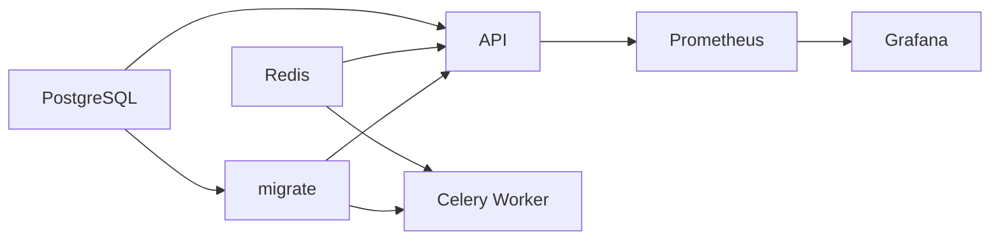

# Python 源码解析第30章：配置、Docker、Cloud 部署与最终证据包

## 模块概览

### 配置加载

`app/config.py` 支持环境变量、`.env` 和 TOML 等来源，并规范化 HTTP base URL。

配置应区分：

- development；
- test；
- Docker Compose；
- cloud。

密钥不能写入 Git 或公开报告。

## 核心类型

### 关键配置

- `LLM_SECURITY_DATABASE_URL`
- `LLM_SECURITY_REDIS_URL`
- `LLM_SECURITY_API_KEYS_JSON`
- `LLM_SECURITY_JWT_SECRET`
- `LLM_SECURITY_ENCRYPTION_KEY`
- `LLM_SECURITY_MODEL_BASE_URL`
- `LLM_SECURITY_MODEL_API_KEY`
- `LLM_SECURITY_QUEUE_MODE`
- `LLM_SECURITY_WORKER_SERVICE_URL`
- `LLM_SECURITY_TASKS_SERVICE_ACCOUNT`

`.env.example` 只能提供占位和开发默认值，真实部署必须替换。

## 主流程走读

### 本地启动

轻量路径使用项目 `.venv` 启动 FastAPI，并可使用 Mock Provider。完整异步路径还需要 Redis/Celery 和数据库。

命令以 `README.md` 与 `docs/interview_evidence_package.md` 当前版本为准。

## 内置部署组件

### Dockerfile

容器包含应用依赖和启动环境。API、Worker 和 migrate 可复用镜像但使用不同 command。

### Docker Compose 服务



主要服务：

- postgres；
- redis；
- migrate；
- api；
- worker；
- prometheus；
- grafana。

### Health Check

- PostgreSQL `pg_isready`；
- Redis `redis-cli ping`；
- API `/health`；
- Worker Celery inspect/ping。

健康检查只证明进程/依赖响应，不代表业务评测正确。

### Migration Gate

`migrate` 服务先运行 Alembic。历史 E2E 产物记录 transactional DDL 和 migration 成功。

### Docker E2E 证据

`llm_security_platform/reports/stage_5_5_docker_e2e.json` 记录：

- status passed；
- API/Worker/PostgreSQL/Redis；
- Alembic upgrade；
- RBAC negative cases；
- audit record；
- failure diagnostics；
- script-controlled Compose。

这是有价值的独立服务边界证据，但报告时间不等于本轮实时重跑。

## 云端执行路径

### Cloud 架构

设计路径：

```text
Cloud Run API
→ Cloud Tasks
→ Cloud Run Worker webhook
→ Cloud SQL / Memorystore
→ GCS
```

Cloud Tasks 使用 OIDC，Worker URL和 service account 从环境变量注入。

### Terraform

Terraform 描述基础设施是“部署路径代码证据”。只有真实 apply、云日志、任务执行和资源状态才能升级为云运行证据。

敏感变量仍可能进入 Terraform state，需要后端加密和访问控制；仓库存在配置不等于问题自动解决。

## 内置扩展能力

### 扩展评测轨道

仓库还包含：

- `app/content_safety/`：HateXplain、分类指标和 rationale；
- `app/crescendo.py`：渐进式攻击；
- `app/multimodal.py`：图像 metadata/OCR/水印风险；
- `app/envoy_simulator.py`：策略过滤模拟。

这些是扩展轨道，不代表默认 async run 自动覆盖全部能力。

## 失败流程与边界条件

### 可以安全声明

> 我实现了内部 LLM/RAG 安全评测平台，支持版本化攻击样本、Provider 适配、异步批量执行、三层防御、Judge/人审、租户 RBAC、审计和报告，并用自动化测试、浏览器 E2E、Docker E2E 与故障演练形成证据链。

### 必须避免

- 企业级生产安全网关；
- 防住全部越狱；
- 100% 安全；
- 已验证真实 ROI；
- Cloud 原生生产稳定运行；
- 全自动替代人审；
- 通用 Agent/MCP/多 Agent 平台。

## 测试与证据

### 测试证据分级

| 证据 | 能证明 |
|---|---|
| Pytest | 测试条件下的函数/API 行为 |
| Mock Provider | 可重复评测流程 |
| Browser E2E | Console 到异步报告闭环 |
| Docker E2E | 独立服务和依赖边界 |
| Fault drill | 指定故障场景恢复 |
| Real-model report | 指定模型/数据/配置表现 |
| Cloud smoke/log | 指定云环境执行 |
| 真实业务数据 | 用户价值、事故降低或 ROI |

最后一项仓库中未验证。

### 现有关键产物

- `reports/browser_e2e_console_report.json`
- `llm_security_platform/reports/stage_5_5_docker_e2e.json`
- `stage_5_6_fault_drill.json`
- `stage_four_defense_ablation.json`
- `stage_4_5_real_model_ablation.json`
- `docs/interview_evidence_package.md`

### 测试数量表述

本轮在仓库根目录实际执行：

```powershell
.\.venv\Scripts\python.exe -m pytest -q
```

结果为 `139 passed, 1 warning in 114.59s`。唯一告警来自 `.venv` 中 FastAPI/Starlette `TestClient` 对 `httpx` 的第三方弃用提示，没有出现仓库内部测试失败。该结果验证的是当前自动化测试集合，仍不能替代真实模型、真实云环境或真实用户效果证据。

## 面试追问

### 三分钟证据展示

1. README 一句话和架构；
2. Console 创建 Mock run；
3. 展示 case evidence chain；
4. 展示 Browser/Docker E2E 报告；
5. 展示防御消融；
6. 主动说明 Mock、Cloud 和真实业务边界。

## 小结

部署文件说明系统如何运行，证据产物说明它在什么条件下运行过，边界说明这些结果不能外推到哪里。三者必须一起展示。
