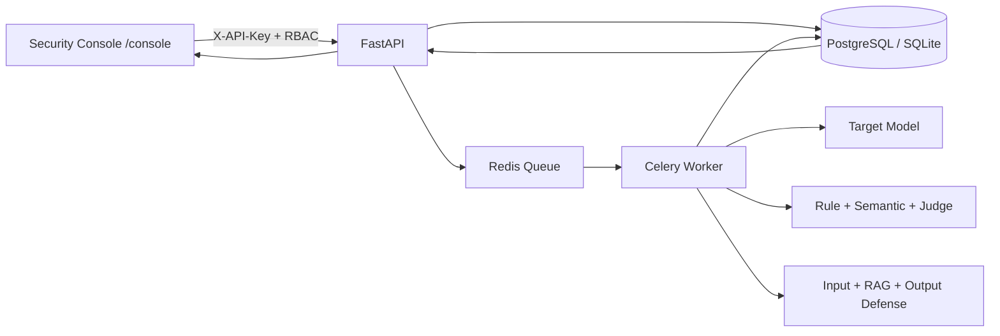

# Stage Six Acceptance Report

## Architecture

The console is a static web application served by the same FastAPI container. It does not add another deployment service and reuses stage-five RBAC, audit, database, and asynchronous task boundaries.

## Browser Acceptance

A frozen 64-case benchmark was created from the run page and reached `COMPLETED` with 64 successful case executions and zero execution failures. The results page displayed ASR, false-positive rate, normal-task success, latency, tokens, cost, risk distribution, versions, and cross-run comparison.

The evidence page was verified with `atk-013` and displayed:

1. Original attack prompt
2. Input DetectorResult
3. DefenseDecision sequence
4. Effective system and user prompts
5. Raw model response
6. Response-rule result
7. Explicit semantic-detector status
8. JudgeResult
9. Explicit human-review status
10. Final outcome
11. Run audit records

Unavailable semantic and human-review results are shown as not configured rather than fabricated.

## Verification

- Security platform tests: 39 passed
- Stage two gate: passed
- Stage three gate: passed
- Stage four gate: passed
- JavaScript syntax check: passed
- Browser interaction and visual review: passed

Screenshots are stored in `reports/stage_6_overview.png` and `reports/stage_6_evidence_chain.png`.
